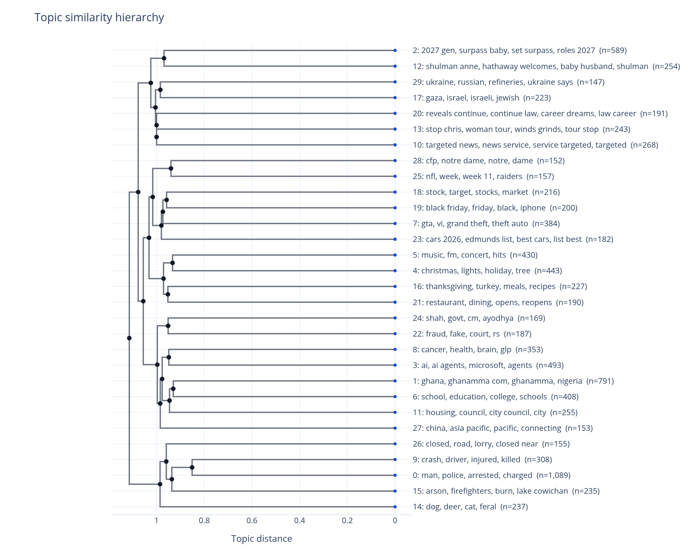
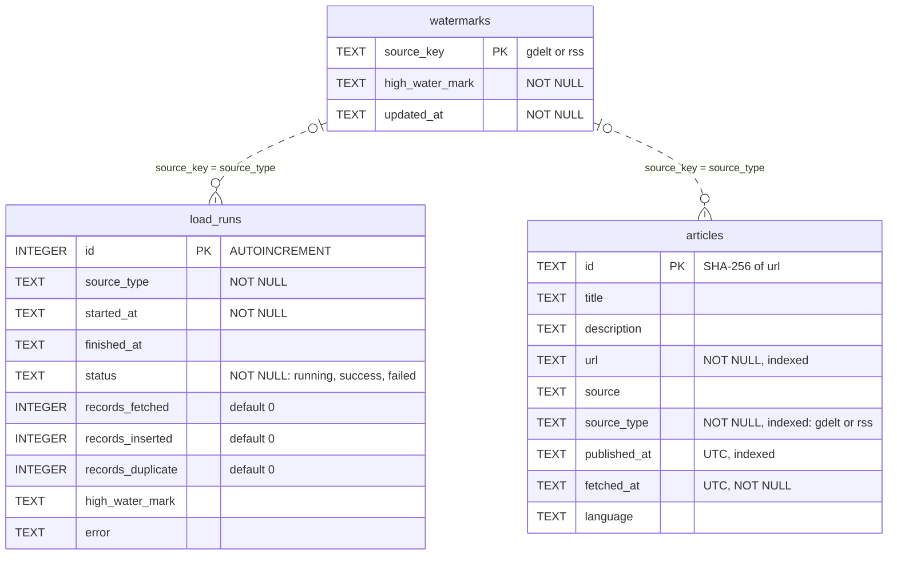

# Headline Radar

Headline Radar pulls live news headlines from GDELT and seven RSS feeds into a local database, then finds the topics in them with a topic model I wrote from scratch. Every 15 minutes there are thousands of new headlines. Headline Radar groups them into a few hundred readable topics, names each one with keywords, and shows how the topics relate.

See the full walkthrough: [Topic model notebook](experiments/topic_model.ipynb)



*How to read this chart:* each row on the right is a topic, with its top keywords and its number of articles. Lines join topics that use similar words. The further left two branches meet, the less alike they are, so pairs that join close to the right are the most similar. In this run, the Ukraine and Russia topic sits next to the Gaza and Israel topic, and NFL joins college football (CFP, Notre Dame). The closest pair is crashes and injuries next to police, arrests, and charges. Stock market headlines sit beside Black Friday and iPhone deals. The chart covers 41,277 articles and 283 topics.

## Why it matters

Most organizations have more free text than anyone can read. Topic modeling turns that text into a short list of themes you can count, track, and act on.

With news, that means you can:

- Spot new stories and market-moving themes early, as a new topic appears or grows.
- Track how coverage of a company, sector, or region changes from week to week.
- Route and triage a large stream of headlines to the right people.

The engine does not know anything about news. Point it at any column of short texts and it works the same way. Good fits are support tickets, customer feedback, invoice or claim notes, and survey responses.

## What this shows

I am a Lead Data Scientist. At Signature Aviation I built the enterprise AI platform, covering data engineering, forecasting, dynamic pricing, and MLOps governance. This project shows the same habits on open data.

- **My own BERTopic-style model, not a black box.** Sentence embeddings with attention-mask mean pooling, UMAP to reduce them, HDBSCAN to cluster them, and c-TF-IDF to name the topics. Each step is a small, readable method.
- **A loader you can rerun safely.** Each article id is the SHA-256 of its URL, so reloads never add duplicates. A watermark per source means each run only pulls new data.
- **Clear handling of edge cases.** Topic `-1` means a text did not fit any topic. Topic `-2` means the text was blank. The two are never mixed.
- **Honest predictions.** For each text, `transform_with_status` says whether it was in the training data (`seen`), was predicted (`new`), or was blank.
- **Safe joins.** `TopicJoiner` adds topic ids to a table without ever adding rows, and it raises an error when the data has drifted from the fitted model.
- **Diagnostics you can check.** `get_fit_diagnostics` shows how cluster sizes changed after identical texts were given one shared topic.
- **The right size of tools.** pandas and SQLite instead of Spark and a database server, because the data fits on one machine.
- **Tested on real data.** 41,277 articles became 283 topics, with 40% left as outliers. The full run took about 3.5 minutes on CPU.

Some topics pick up publisher boilerplate, such as "targeted news service". The example texts for each topic make those easy to spot and relabel.

## Code highlights

- **[TextEmbedder](models/TextEmbedder.py)** builds sentence embeddings straight from the raw transformer output. It averages token vectors with the attention mask so padding never counts, then scales each vector to length 1. It needs no sentence-transformers package and can save and reload the model for offline use.
- **[TopicModel](models/TopicModel.py)** is my own BERTopic-style pipeline: UMAP, HDBSCAN, and class-based TF-IDF. Copies of the same text vote on one shared topic, and topics that shrink below the minimum size after the vote are pruned again. It tells seen texts from new ones, predicts new ones with HDBSCAN `approximate_predict`, and reports fit diagnostics.
- **[OutlierReducer](models/OutlierReducer.py)** builds L2-normalized embedding centroids for each discovered topic and reassigns remaining `-1` outliers whose cosine similarity clears a threshold (default `0.45`), while flagging reassigned rows with `is_reassigned_outlier` and leaving `-2` blanks untouched.
- **[TopicHierarchyPlot](models/TopicHierarchyPlot.py)** compares topics by the cosine distance between their c-TF-IDF vectors and links them with Ward linkage. The Plotly dendrogram shows the combined keywords at every merge point when you hover.
- **[TopicJoiner](models/TopicJoiner.py)** joins topic ids back onto a table by exact text. It checks that the join keeps the row count, gives blank text `-2`, and raises an error on conflicting ids or on text the model has never seen, which is a sign of drift.
- **[TopicExplorer](models/TopicExplorer.py)** writes one self-contained HTML page: a 2D UMAP map of every unique text colored by topic, a bar chart of topic sizes, and a table of keywords and example texts. It works offline.
- **[GdeltLoader](de/GdeltLoader.py) and [RssLoader](de/RssLoader.py)** share one base class, [NewsLoader](de/NewsLoader.py), that logs every run and advances the watermark only after a successful load. The GDELT loader walks the 15-minute files from the last watermark, saves progress after each file, and retries a file on the next run if it is not published yet. Files still missing after a 45-minute grace period are skipped.

## How the topic model works

`models/TopicModel.py` works on any list of short texts.

1. Embed each unique text with `TextEmbedder` (MiniLM).
2. Reduce the embeddings to 5 dimensions with UMAP.
3. Cluster with HDBSCAN.
4. Give identical texts the same topic. Move any topic smaller than `min_topic_size` to the outliers.
5. Optionally reassign remaining `-1` outliers to their closest topic centroid when cosine similarity clears `outlier_min_similarity`.
6. Number topics by size, so topic 0 is the largest.
7. Describe each topic with c-TF-IDF keywords and three example texts.

```python
from models import TopicModel

model = TopicModel(min_topic_size=30)
topic_ids = model.fit_transform(texts)        # texts must be nonblank
print(model.get_topic_info())                 # topic_id, document_count, topic_name, top_words, ...
print(model.get_fit_diagnostics())            # cluster sizes before and after the duplicate vote

model.transform_with_status(["Fed signals another rate cut", ""])
# topic_id per text, with status "seen", "new", or "blank"

model.visualize_hierarchy(top_n_topics=30).show()
model.save("data/topic_model")
model = TopicModel.load("data/topic_model")
```

Texts from the fit data get their fitted topic back. New texts are placed with HDBSCAN `approximate_predict`. The model only knows the data it was fit on, so refit it as new headlines arrive.

`TopicJoiner` adds a `topic_id` column to a pandas DataFrame by exact text match. It never adds rows and gives blank text `-2`. It raises an error if one text has two topic ids, or if a text is missing from the lookup, which means the model needs a refit.

## Setup

The project runs on Windows, macOS, and Linux. Use Python 3.11 or later.

```text
cd headline-radar
python -m venv .venv
```

Activate the virtual environment:

- Windows: `.venv\Scripts\activate`
- macOS / Linux: `source .venv/bin/activate`

```text
pip install -r requirements.txt
```

## Load the news

From the project root:

```text
python -m de.load_news
```

Useful options:

```text
python -m de.load_news --source all
python -m de.load_news --source gdelt --backfill-hours 6
python -m de.load_news --source rss
python -m de.load_news --database data/headline_radar.db
```

- `--source` is `all` (default), `gdelt`, or `rss`.
- `--backfill-hours` is used for GDELT only when no high-water mark has been stored yet. Later runs start from the watermark and pull only new data.
- The SQLite file is created automatically at `data/headline_radar.db`.

Re-run the same command at any time. Already-stored URLs are skipped and counted as duplicates.

## Run the topic model

```text
python -m models.run_topic_model
python -m models.run_topic_model --min-topic-size 20 --min-samples 5 --outlier-min-similarity 0.45 --output-folder outputs
```

`TopicPipeline` reads the articles, fits the model, and saves it to `data/topic_model/`. It writes these files to `outputs/`:

- `document_topics.csv`: one row per article with its topic
- `topic_info.csv`: one row per topic with size, top words, and examples
- `fit_diagnostics.csv`: cluster sizes before and after the duplicate vote
- `topic_hierarchy.html` and `topic_hierarchy.png`: the chart above
- `topic_explorer.html`: a 2D map of every text colored by topic, plus topic sizes and a topic table

The PNG export uses kaleido, which needs Google Chrome. If Chrome is missing, run `kaleido_get_chrome` once.

`experiments/topic_model.ipynb` walks through the same flow in order: load texts, embed, fit, inspect topics, set labels, plot, label new texts, and join topics back to the table. Its charts go to `outputs/notebook/`.

## Project layout

Each class is PascalCase and lives in a file of the same name (for example, `TextEmbedder` is in `models/TextEmbedder.py`). Entry points and function-only modules keep snake_case names, including `python -m de.load_news`. Each `utils/` subfolder exports its classes, so imports read `from utils.storage import Database`.

```text
headline-radar/
  de/                 Incremental loaders and the command-line entry point
    load_news.py      python -m de.load_news
    NewsLoader.py     Base class: run, log, and advance the watermark
    GdeltLoader.py
    RssLoader.py
    LoadResult.py
    FileNotReadyError.py
  utils/              Shared building blocks, grouped by job
    config/           Config, setup_logging
    http/             HttpClient, HttpError
    news/             Article, RssFeed
    storage/          Database
    text/             TextCleaner, HtmlTextExtractor
  models/             Embedding and topic-model classes
    OutlierReducer.py Cosine centroid reassignment for outlier texts
    TextEmbedder.py   MiniLM sentence embeddings
    TopicModel.py     UMAP + HDBSCAN + c-TF-IDF topic model
    TopicHierarchyPlot.py
    TopicJoiner.py    Adds topic ids to a pandas DataFrame
    TopicExplorer.py  Interactive HTML page for browsing topics
    TopicPipeline.py  Fit on the database and write every output
    run_topic_model.py  python -m models.run_topic_model
  experiments/        Walkthrough notebook (topic_model.ipynb)
  docs/images/        Charts used in this README
  outputs/            Tables and charts from the pipeline (ignored by git)
  data/               Local SQLite file (ignored by git)
  requirements.txt
```

## Database design

`data/headline_radar.db` is a SQLite file with three tables. The schema lives in `utils/storage/Database.py`.



The tables are linked by the source name (`gdelt` or `rss`). These links are by value only. There are no foreign key constraints.

- **No duplicates on reload.** `articles.id` is the SHA-256 of the URL, and inserts use `INSERT OR IGNORE`, so rerunning a load skips articles that are already stored.
- **Incremental loads.** `watermarks` keeps one high-water mark per source. The next run starts from it and only pulls new data.
- **An audit log.** `load_runs` gets one row per run, with its status, counts fetched, inserted, and skipped, the high-water mark it reached, and any error.
- **Blanks stay blank.** Missing titles or descriptions are stored as NULL, and the row is kept.
- **Zero setup.** SQLite needs no server. Timestamps are stored as UTC text and the SQL is plain, so moving to Postgres later is simple.

## Data source notes

- GDELT data comes from the 15-minute GKG files advertised by `https://data.gdeltproject.org/gdeltv2/lastupdate.txt`. Titles are read from the GKG `PAGE_TITLE` extras field; a precise publish time is used when `PAGE_PRECISEPUBTIMESTAMP` is present, otherwise the 15-minute file time. GKG does not include article descriptions, so those are stored as NULL. Files are downloaded over HTTPS; the HTTP URLs in lastupdate.txt often return 500. The very newest file listed in lastupdate can 404 for a short time and is retried on the next run. The GDELT DOC 2.0 API also exposes titles, but it rate-limits to one request every five seconds and, during setup, frequently returned HTTP 429 or an empty JSON object, so it is not used here.
- RSS feeds included here: BBC News, NPR News, CNBC Top Stories, Guardian Business, MarketWatch, NYT World, and Al Jazeera. Feeds that did not respond during setup (Yahoo Finance 404, Politico 403, CNN SSL error) were left out.

## Sources

Data:

- [The GDELT Project](https://www.gdeltproject.org/) and its [data and documentation page](https://www.gdeltproject.org/data.html)
- [GDELT 2.0 announcement](https://blog.gdeltproject.org/gdelt-2-0-our-global-world-in-realtime/)
- [GDELT Global Knowledge Graph (GKG) 2.1 codebook](https://data.gdeltproject.org/documentation/GDELT-Global_Knowledge_Graph_Codebook-V2.1.pdf)
- [BBC News RSS](https://feeds.bbci.co.uk/news/rss.xml)
- [NPR News RSS](https://feeds.npr.org/1001/rss.xml)
- [CNBC Top Stories RSS](https://www.cnbc.com/id/100003114/device/rss/rss.html)
- [Guardian Business RSS](https://www.theguardian.com/uk/business/rss)
- [MarketWatch real-time headlines RSS](https://feeds.content.dowjones.io/public/rss/mw_realtimeheadlines)
- [NYT World RSS](https://rss.nytimes.com/services/xml/rss/nyt/World.xml)
- [Al Jazeera RSS](https://www.aljazeera.com/xml/rss/all.xml)

Methods:

- Reimers and Gurevych (2019). [Sentence-BERT: Sentence Embeddings using Siamese BERT-Networks](https://arxiv.org/abs/1908.10084).
- Wang et al. (2020). [MiniLM: Deep Self-Attention Distillation for Task-Agnostic Compression of Pre-Trained Transformers](https://arxiv.org/abs/2002.10957).
- [all-MiniLM-L6-v2 model card](https://huggingface.co/sentence-transformers/all-MiniLM-L6-v2) on Hugging Face.
- McInnes, Healy, and Melville (2018). [UMAP: Uniform Manifold Approximation and Projection for Dimension Reduction](https://arxiv.org/abs/1802.03426). [umap-learn docs](https://umap-learn.readthedocs.io/en/latest/).
- Campello, Moulavi, and Sander (2013). [Density-Based Clustering Based on Hierarchical Density Estimates](https://link.springer.com/chapter/10.1007/978-3-642-37456-2_14). [hdbscan library docs](https://hdbscan.readthedocs.io/en/latest/).
- Grootendorst (2022). [BERTopic: Neural topic modeling with a class-based TF-IDF procedure](https://arxiv.org/abs/2203.05794). The idea behind this project. The code here is an independent implementation and does not use the BERTopic library. [BERTopic docs](https://maartengr.github.io/BERTopic/).

Tools:

- [Hugging Face Transformers](https://huggingface.co/docs/transformers/index)
- [scikit-learn](https://scikit-learn.org/stable/)
- [pandas](https://pandas.pydata.org/)
- [Plotly for Python](https://plotly.com/python/)
